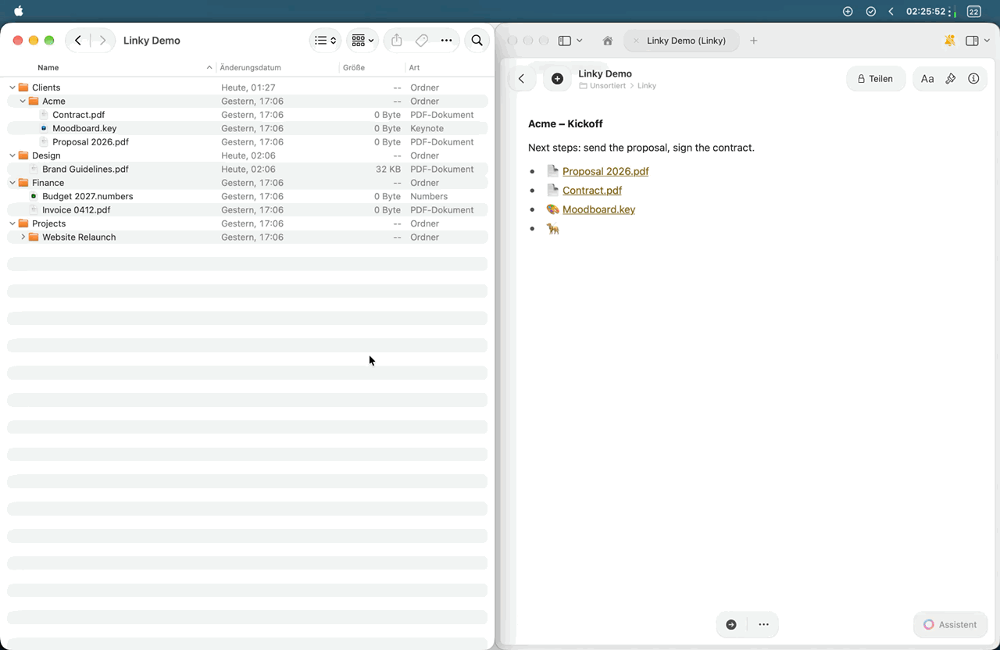

<p align="center">
  
</p>

<h1 align="center">Linky</h1>

<p align="center">
  <b>Copy a link to any file or folder on your Mac. Paste it into your notes, tasks or docs. Click it – the file opens.</b><br>
  No upload, no download, no copies.
</p>

<p align="center">
  <a href="../../releases/latest"><b>Download Linky</b></a> · macOS 26 or later · free<br>
  
</p>

<p align="center">
  
</p>

---

Your notes, tasks and docs are where the context lives – but your files live in Finder. Attaching them means uploading copies that you have to download again to open, and that quietly go out of date. Linky leaves the file where it is and gives you a link to it instead.

Use it for the contract next to your meeting notes, the design file in a task, the folder of a project in its brief, the invoice in an email draft.

## How it works

1. Select a file or folder in Finder.
2. Press **⌃⌥⌘L** – or right-click › Services › **Copy Linky Link**.
3. Paste it wherever links are clickable – Craft, Apple Notes, Obsidian, Bear, Things, Mail … You get the file name as a link.
4. Click it to open the file. **⌥-click** shows it in Finder.

Links keep working when you **rename or move** the file. If a file is deleted, Linky lists the broken link so you can **relink** it to a new file – every place you pasted the link then opens the new one.

Linky lives in the menu bar: your recent links are one click away, ready to copy again.

<picture>
  <source media="(prefers-color-scheme: dark)" srcset="docs/settings-dark.png">
  
</picture>

## Install

1. Download **Linky.zip** from the [latest release](../../releases/latest), unzip it and move **Linky.app** to your Applications folder.
2. Open it. macOS will warn that it can't verify the developer, because Linky isn't notarized by Apple.<br>
   Go to **System Settings › Privacy & Security**, scroll down and click **Open Anyway**.
3. The first time you press the shortcut, allow Linky to control Finder. It only reads which files are selected.

## Good to know

- **Three formats:** a linked file name (rich text), Markdown for Markdown editors, or the plain URL – pick one in Settings.
- **Links point to files on *your* Mac.** A link looks like `linky://open?id=…`. Someone you share a note with can't open it, unless they have Linky and the same file at the same path.
- **Everything stays local.** Links are stored in `~/Library/Application Support/Linky/links.json`. No account, no network, no tracking.
- The shortcut can be changed in Settings (menu bar › Settings…).
- **Transparency**  I'm just a simple guy, so Linky was built with AI (Claude Code). The idea, the design and the testing are mine. The full source is on GitHub, so you can check exactly what it does.

## Raycast

The companion extension in [`raycast-extension`](raycast-extension) adds two commands to Raycast. It needs Linky 1.3 or later.

- **Copy Linky Link**: link the files selected in Finder.
- **Search Linky Links**: search every link you made, copy it again, open the file or show it in Finder.

It isn't in the Raycast Store yet. To try it, run this once and Raycast picks it up:

```bash
cd raycast-extension && npm install && npm run dev
```

## Build from source

Requires Xcode / Swift 6.2 or later.

```bash
./scripts/build.sh            # builds build/Linky.app
./scripts/build.sh --install  # also installs to /Applications and starts it
./scripts/build.sh --zip      # also creates build/Linky.zip for a release
```

## Support

Linky is free and stays free. If it saves you a few clicks every day, you can [buy me a coffee ☕](https://buymeacoffee.com/trugschluss) – thank you!

## License

[MIT](LICENSE). The link icon is from [Feather](https://feathericons.com) (MIT) – see [third-party notices](THIRD_PARTY_NOTICES.md).
