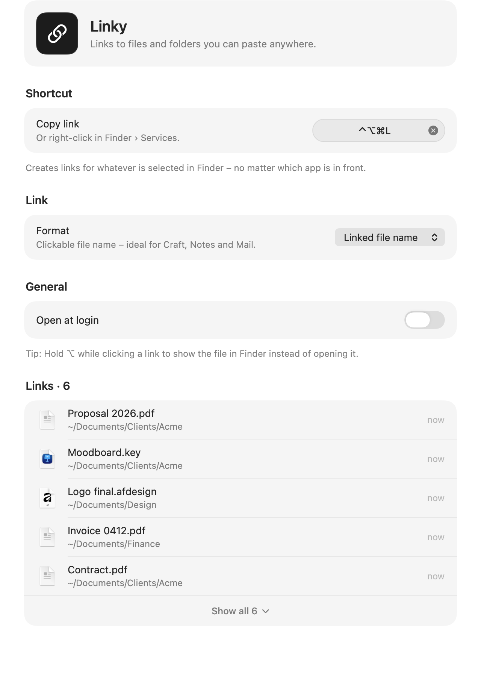

<p align="center">
  
</p>

<h1 align="center">Linky</h1>

<p align="center">
  <b>Copy a link to any file or folder on your Mac. Paste it into Craft. Click it – the file opens.</b><br>
  No upload, no download, no copies.
</p>

<p align="center">
  <a href="../../releases/latest"><b>Download Linky</b></a> · macOS 26 or later · free
</p>

---

When you attach a file to a Craft document, you can't just open it – you have to download it first, and then you have two versions. Linky leaves the file where it is and gives you a link to it instead.

## How it works

1. Select a file or folder in Finder.
2. Press **⌃⌥⌘L** – or right-click › Services › **Copy Linky Link**.
3. Paste into Craft. You get the file name as a clickable link.
4. Click it to open the file. **⌥-click** shows it in Finder.

Links keep working when you **rename or move** the file. If a file is deleted, Linky lists the broken link so you can **relink** it to a new file – every place you pasted the link then opens the new one.

Linky lives in the menu bar: your recent links are one click away, ready to copy again.

<picture>
  <source media="(prefers-color-scheme: dark)" srcset="docs/settings-dark.png">
  
</picture>

## Install

1. Download **Linky.zip** from the [latest release](../../releases/latest), unzip it and move **Linky.app** to your Applications folder.
2. Open it. macOS will warn that it can't verify the developer, because Linky isn't notarized by Apple.<br>
   Go to **System Settings › Privacy & Security**, scroll down and click **Open Anyway**.
3. The first time you press the shortcut, allow Linky to control Finder. It only reads which files are selected.

## Good to know

- **Works in any app that accepts links** – Craft, Notes, Mail, Obsidian, Things … Settings let you choose between a linked file name, Markdown or the plain URL.
- **Links point to files on *your* Mac.** A link looks like `linky://open?id=…`. Someone you share a Craft doc with can't open it, unless they have Linky and the same file at the same path.
- **Everything stays local.** Links are stored in `~/Library/Application Support/Linky/links.json`. No account, no network, no tracking.
- The shortcut can be changed in Settings (menu bar › Settings…).

## Build from source

Requires Xcode / Swift 6.2 or later.

```bash
./scripts/build.sh            # builds build/Linky.app
./scripts/build.sh --install  # also installs to /Applications and starts it
./scripts/build.sh --zip      # also creates build/Linky.zip for a release
```

## License

[MIT](LICENSE)
